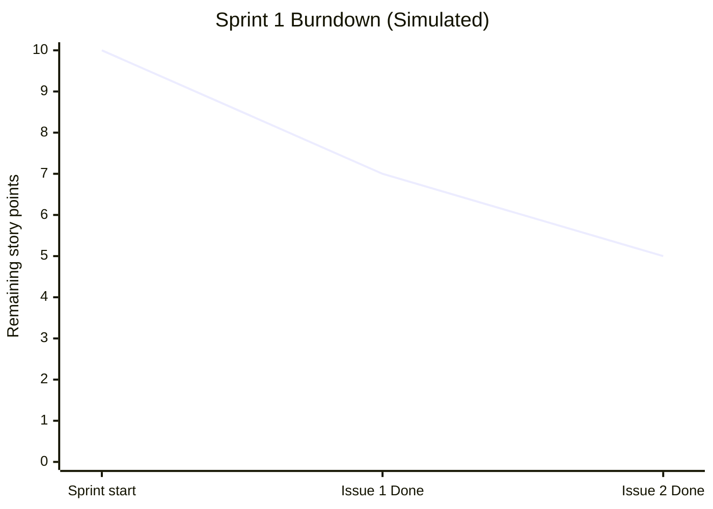

# Sprint 1 Burndown — Simulated Sprint

**Sprint:** Sprint 1 · November 6–19, 2026 · 2 weeks  
**Scope:** Issues #1–#4 · **10 story points** · **Completed: 5** · **Remaining: 5**

This is an event-based simulation for the IBM Agile Final Project, not historical daily telemetry. The sequence models the planned work and the final board states. No application code was created.

| Simulation event | Completed points | Remaining points |
|---|---:|---:|
| Sprint planned: #1 (3), #2 (2), #3 (3), #4 (2) | 0 | 10 |
| Issue #1 moves to Done | 3 | 7 |
| Issue #2 moves to Done (current snapshot) | 5 | 5 |

## Final board verification

| Issue | Estimate | Sprint | Status | Assignee | Label |
|---|---:|---|---|---|---|
| [#1](https://github.com/sree-siva/agile-final-project/issues/1) | 3 | Sprint 1 | Done | sree-siva | enhancement |
| [#2](https://github.com/sree-siva/agile-final-project/issues/2) | 2 | Sprint 1 | Done | sree-siva | enhancement |
| [#3](https://github.com/sree-siva/agile-final-project/issues/3) | 3 | Sprint 1 | In Progress | sree-siva | enhancement |
| [#4](https://github.com/sree-siva/agile-final-project/issues/4) | 2 | Sprint 1 | Sprint Backlog | sree-siva | enhancement |

Issues #7 and #8 remain in Icebox. Issues #5, #6, #9, and #10 remain in Product Backlog. Issues #9 and #10 carry the technical debt label.
